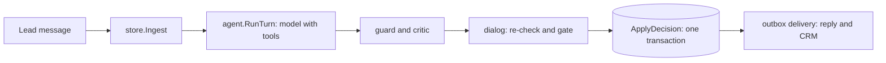

# lead-qualifier

LLM agent that qualifies B2B leads in chat: the model talks, deterministic Go code decides.

[](https://github.com/daniil4545/lead-qualifier/actions/workflows/ci.yml)
[](https://github.com/daniil4545/lead-qualifier/releases)
[](LICENSE)


A bot talks to a person who left a request: it answers questions from a knowledge base, collects five facts about the company, decides whether to invite the lead to a meeting, and books a slot with a manager. The LLM runs the conversation and brings facts; Go code makes every decision: the meeting gate, the price, the booking.

The project is small enough to read in an evening: a console transport, an in-memory fake CRM, Postgres in Docker, OpenRouter as the model gateway. The company in the catalog ("Тихая гавань", a managed IT support vendor) is fictional, and all business data in `data/example` is made up.

User-facing texts are in Russian: the agent talks to Russian-speaking leads, so the prompts, the catalog content and the golden dialogs stay in Russian. Everything meant for developers is in English.

## Features

| What | In one line |
|---|---|
| Decisions in code | the meeting gate, tariff and booking admission are table-tested Go, not prompt text |
| Tool refusal as an answer | a forbidden tool call gets a reason; `dialog` re-checks the boundary |
| Guard and critic | deterministic filters plus a strict-JSON model check on every draft, separate regeneration budgets |
| Model failure is not a decision | deferred replay at 1, 2, 4 minutes, then a human gets a ready reply and a CRM task |
| Outbox and journal | decision, booking and outgoing rows in one transaction; a unique index stops double booking |
| Catalog as data | company, tariffs, niches, managers, texts, prompts and knowledge base are files; a second catalog runs the same tests |
| Offline demo | the whole pipeline on a scripted stand-in for the model: no key, no network |
| Prompt evaluation | `prompteval` runs 15 golden classes through a live model and reports the pass rate |

## Install

Needs Go 1.25 or newer and Docker (Postgres 16 from `docker-compose.yml`).

```sh
git clone https://github.com/daniil4545/lead-qualifier
```

The demo reads the catalog from `data/example`, so it runs from the clone. Releases carry notes, no binaries.

## Quick start

1. Start the offline demo. It brings up Postgres, creates the schema and runs the console conversation on a scripted stand-in for the model:

   ```sh
   make demo-offline
   ```

   Every run books a slot in the local database; `docker compose down -v` resets it.

2. Type the lead's name, then the lead's lines, one at a time. The bot answers after each. This is a real run; lines marked `>` are typed, window dates depend on the day you run it:

   ```text
   Имя лида: > Олег
   [CRM lead lead-1] Олег

   Бот: Здравствуйте, Олег! Меня зовут Вера, я помогаю команде «Тихой гавани» с заявками. ...

   > А сколько времени занимает подключение?
   Бот: Подключение занимает от одной до двух недель: инженер проводит аудит, ...

   > У нас сеть из четырёх магазинов стройматериалов в Бердске, выручка около 12 млн в месяц. Я генеральный директор и владелец.
   Бот: Вот ближайшие свободные окна для встречи с менеджером:
   - четверг, 22 октября: 09:00-14:00 включительно
   - понедельник, 26 октября: 09:00-14:00 включительно
   - вторник, 27 октября: 09:00-14:00 включительно
   Время новосибирское. Напишите, какой день и час вам удобны.

   > Давайте в 11
   Бот: Записала вас на встречу 22 октября в 11:00 по новосибирскому времени. Встречу проведёт Павел, длительность около 60 минут. До встречи!

   [CRM note lead-1] Квалификатор: назначена встреча 22 октября в 11:00, менеджер Павел. Услуга: сеть из четырёх магазинов стройматериалов; выручка: 12000000; роль: генеральный директор; собственник: да; город: Бердск; направление: розничная торговля.
   [CRM task lead-1, менеджер pavel] Встреча 22 октября в 11:00 с лидом Олег. ...
   ```

   Logs go to `demo.log`. Close the input with Ctrl+D.

3. The offline model is a rule-based stub (`internal/stubmodel`) for this dialog. For a real model use your own OpenRouter key:

   ```sh
   export OPENROUTER_API_KEY=...
   make demo
   ```

   The default model is `google/gemini-2.5-flash`, set in `data/example/config.json`.

## Configuration

| Variable | Default | Meaning |
|---|---|---|
| `DATABASE_URL` | `make` sets the compose database on port 55432 | Postgres connection string, required |
| `OPENROUTER_API_KEY` | none | required for `make demo` and `prompteval`; not needed with `--offline` |
| `OPENROUTER_MODEL` | `model` of the catalog | model of the dialog turn |
| `OPENROUTER_CRITIC_MODEL` | the dialog model | model of the critic and the niche classifier |
| `OPENROUTER_URL` | OpenRouter chat completions | endpoint, for a proxy or a test double |
| `CATALOG_DIR` | `data/example` | catalog directory |
| `LOG_LEVEL` | `info` | log level of the demo |
| `LQ_LIVE_MODEL` | unset | `1` enables the live niche classifier test |

## How it works



One agent turn is a loop of model calls with native tool calling. The tools are `search_kb`, `save_facts`, `complete`, `offer_slots`, `book_slot`, `escalate`, `refuse` and `stop_contact`. The loop writes nothing itself: it returns an untrusted result, and the `dialog` package validates it and applies it. Details of the case model, the gate outcomes, the invariants and the package map are in [docs/architecture.md](docs/architecture.md).

## Privacy and safety

The demo sends lead messages to the model gateway. What the code promises about that:

| Promise | Checked by |
|---|---|
| Every model call asks the provider not to store data and to honor all parameters | `newRequest` in `internal/agent/openrouter.go` (`data_collection: deny`, `require_parameters`) |
| The API key comes from the environment only, never from a file | `LoadOpenRouter` in `internal/config/config.go`; `.env` is in `.gitignore` |
| Quotes from drafts and provider error bodies go to the decision audit in the database, not to the log | log calls carry ids, categories and counters; see `internal/agent/loop.go` |
| Prices, names, phones, e-mail and links outside the catalog never reach the lead | `internal/agent/guard.go`, table tests in `guard_test.go`, startup validation of the knowledge base |

## Engineering decisions

The central idea: the model brings facts and writes text, the code decides. Every item below is something that can fail in a lead-facing bot, what I did about it, and what I rejected.

1. **Decisions are code, not prompt.** The meeting gate computes the niche segment, the revenue thresholds and the tariff from the catalog: the price from the lower bound of the revenue range, the admission from the upper bound. The same facts always give the same outcome, so the gate is covered by ordinary table tests. Rejected: putting acceptance rules into the prompt. A prompt can set the tone, but a rule that lives there can be talked out of the model.
2. **Tool refusal is a tool answer, and it is checked twice.** Slots and booking are unavailable before the niche verdict, before the full set of facts, with a closed gate and with an already booked meeting. The agent answers a forbidden call with the reason, so the model understands and continues the conversation. `dialog` then re-checks the same boundary before booking, because the turn result is untrusted: a stub or a model failure must not produce a meeting that bypasses the gate. Rejected: rebuilding the tool schema per state, which gives the model no explanation, and trusting the model not to call a tool it was told is unavailable (a prompt injection asks for exactly that, and there is a test for it).
3. **Two independent filters on every draft.** The guard is a set of deterministic filters: foreign prices, amounts when the tariff is unknown, names of third parties (with Russian cases and in transliteration), phones, e-mail, links outside the catalog, retelling of internal rules. The critic is a separate strict-JSON model call that checks facts against the issued knowledge base fragments, promises and manipulation. A guard false positive costs one regeneration, a miss is a leak, so the filters are stricter than necessary. A rejected draft goes back to regeneration with a specific remark per category, never to the lead. Each filter has its own regeneration budget (two), because a shared budget let the critic use up the guard's attempt. Rejected: the critic alone, which is not reproducible and cannot carry a test per rule.
4. **Untrusted input everywhere.** Facts are sanitized and length-limited before they enter the trusted context. Time and price are printed by Go and the model only repeats them. Remarks from the code are marked with a prefix so the model does not answer them aloud, and the guard has a separate echo filter for the case when it does. The niche is classified by a separate model call, not by a `save_facts` field: the dialog model edits facts every turn and would rewrite the code to fit the conversation. An unclear classifier answer gives an unconfirmed profile and a meeting, never a refusal.
5. **A model failure is not a decision.** A transport error, an empty answer, two broken `save_facts` in a row or a critic error defer the turn (1, 2, 4 minutes) and replay it. After three deferrals the case goes to a human with a ready reply and a CRM task. Rejected: letting a failed turn fall through to "no answer" or to a guessed outcome.
6. **State is a projection plus a journal, delivery is an outbox.** The case row is a projection; `decisions` and `case_events` are the journal. The reply to the lead, the CRM note and task, and the booking are written in the same transaction as the decision, and delivered afterwards from the outbox with the row key as the idempotency key. A double booking is stopped by a unique index on (manager, start), not by window selection: when two turns race for one window, the loser gets fresh windows instead of a confirmation of a booking that does not exist. Rejected: calling the CRM or the transport inside the turn.
7. **Business data lives in a catalog directory.** Company, persona, time zone, work hours, tariffs, niche segments, managers, ready texts, prompts and the knowledge base are files in `CATALOG_DIR`. A test fails if a catalog value appears as a literal in Go code, and a second catalog (`testdata/catalog-alt`: other company, thresholds, tariffs, zone, meeting length and persona) runs through the same table tests as the first. The five-fact schema stays in code: a data-driven schema would add nothing and make the gate harder to test.
8. **The knowledge base is validated at start.** Anything in it the model may repeat verbatim, so startup rejects prices that are not catalog tariff prices, links outside the catalog, phones, e-mail and stop names, and requires the table of contents to list exactly the existing sections. The catalog itself is checked too: a broken catalog refuses to start, because a running service with it would name a wrong price or time to a lead.
9. **Offline evaluation first, live model second.** `data/example/golden` holds 15 classes of one-turn fixtures (full facts, knowledge base question, injection, price insistence, slot choice, reschedule, and so on). Offline, the fixtures are checked for consistency against the tool contract and the catalog. `prompteval` runs them through a live model n times and reports the pass rate, unsafe outcomes and divergence classes; transport failures are counted separately and fail the run. A fixture checks the action, the tool arguments, the facts snapshot and forbidden substrings. It does not judge the quality of the text: that stays with the critic and a human.
10. **Boring infrastructure.** JSON config on the standard library, one idempotent migration at start, `pgx` for Postgres, no framework, packages split by domain boundary. Rejected: deferred follow-up touches for silent leads (they need a scheduler, and the project has none) and a refusal that waits for revenue growth, for the same reason.

## Catalog and prompt evaluation

Everything that differs between customers (company, persona, tariffs, niches, managers, texts, prompts, knowledge base, golden fixtures) is a file in `CATALOG_DIR`, default `data/example`. To plug in your own business, copy it, fill it in and run with `CATALOG_DIR=path`.

`make prompteval ARGS="-n 3"` runs the 15 golden fixture classes through a live model n times and reports the pass rate, unsafe outcomes and divergence classes; it needs an OpenRouter key. The file layout and a fixture example are in [docs/catalog.md](docs/catalog.md).

## Tests

```sh
make test-fast   # no database
make test        # with Postgres from docker-compose
make check       # gofmt, vet, golangci-lint, full tests, build
```

The offline demo has an end-to-end test on a temporary database (`cmd/lead-qualifier/demo_test.go`). The live niche classifier test is enabled with `LQ_LIVE_MODEL=1`. CI runs build, vet, gofmt, golangci-lint and the full suite against a Postgres service.

## Limitations

- A working reference implementation, not a deployable product. The only transport is the console, the only CRM is an in-memory fake; real integrations would implement the `Sender` and `crm.CRM` interfaces.
- One process, one database. There is no scheduler, so a silent lead gets no follow-up touches and a refusal on revenue closes the case.
- The golden fixtures cover one turn per class, not whole conversations. I have not published pass rates for any model: run `make prompteval` against the model you intend to use.
- The offline model is a scripted stub for one dialog. It shows the pipeline around the model, not the quality of a model.
- The guard filters and the catalog texts target Russian; another language needs new patterns, prompts and texts.

## License

MIT, see [LICENSE](LICENSE).
